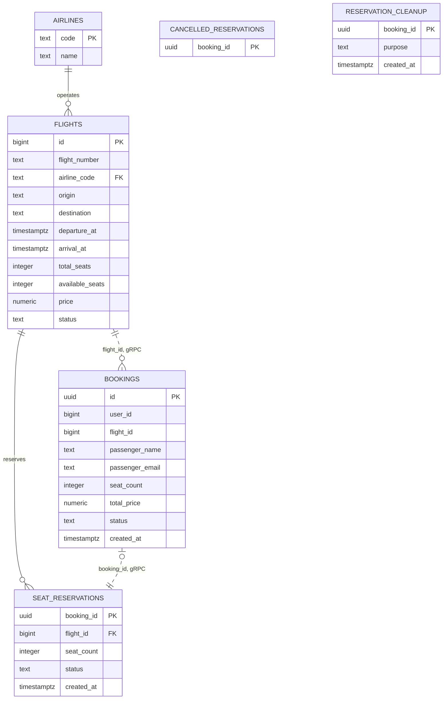

AIRLINES, FLIGHTS, SEAT_RESERVATIONS и CANCELLED_RESERVATIONS находятся в БД Flight Service. BOOKINGS и RESERVATION_CLEANUP — в БД Booking Service. Пунктирные связи проверяются через gRPC, внешних ключей между БД нет. У каждого сохранённого бронирования ровно одна резервация; после неудачной попытки может остаться RELEASED-резервация без бронирования.

Название авиакомпании вынесено в AIRLINES: оно зависит от её кода. У рейса уникальны номер и UTC-дата вылета. Названия аэропортов не дублируем, храним только IATA-коды. Данные пассажира относятся к конкретному бронированию, user_id не определяет пассажира. total_price — снимок стоимости бронирования. Во всех таблицах неключевые атрибуты зависят от ключа без транзитивных зависимостей.

RESERVATION_CLEANUP хранит незавершённые операции возврата мест. CANCELLED_RESERVATIONS запрещает запоздалому ReserveSeats создать резерв после компенсации.
