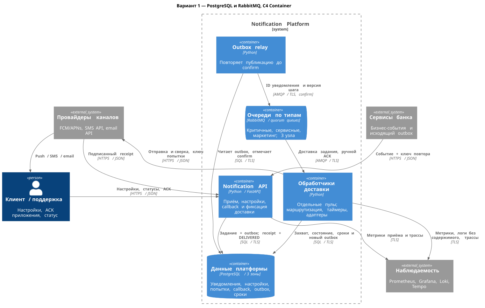
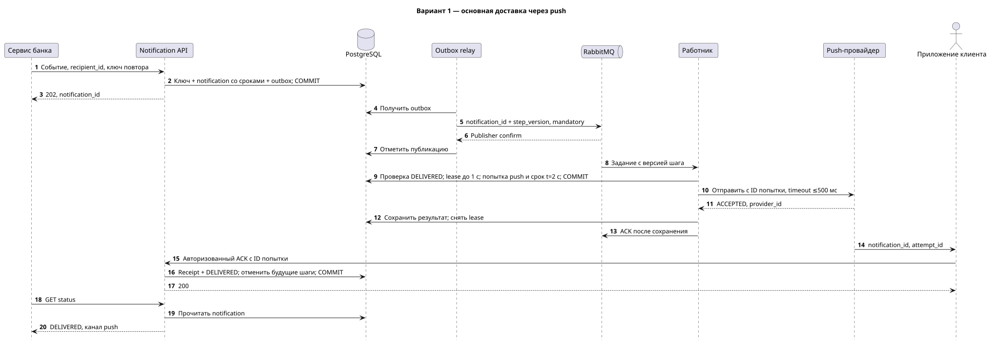
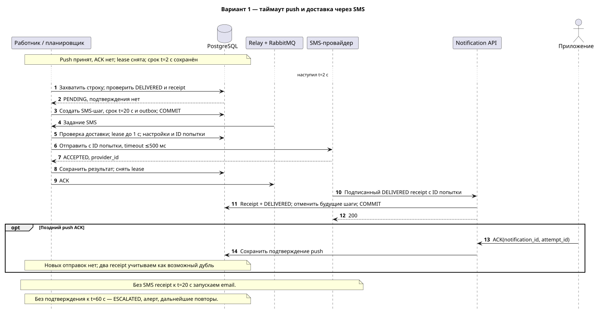
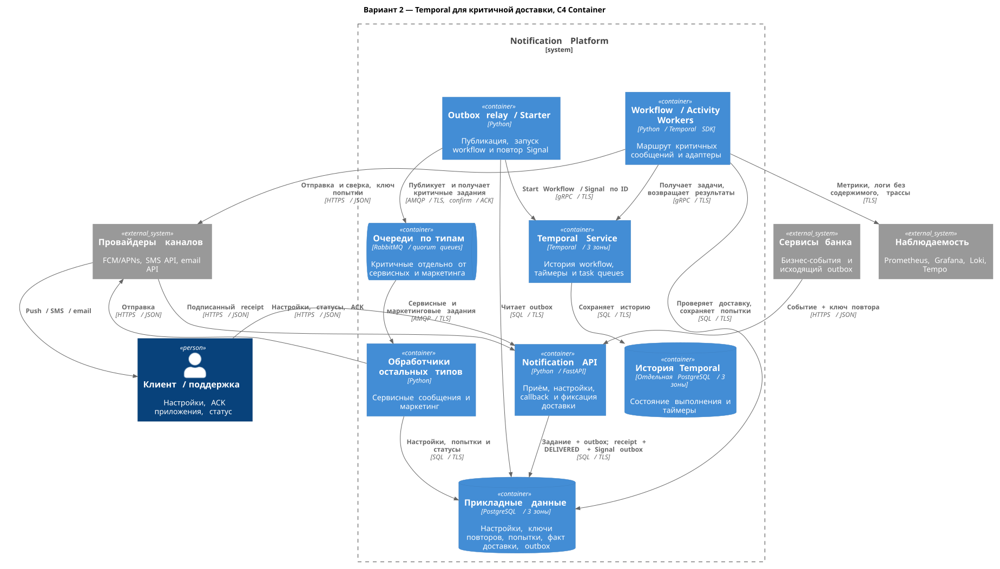
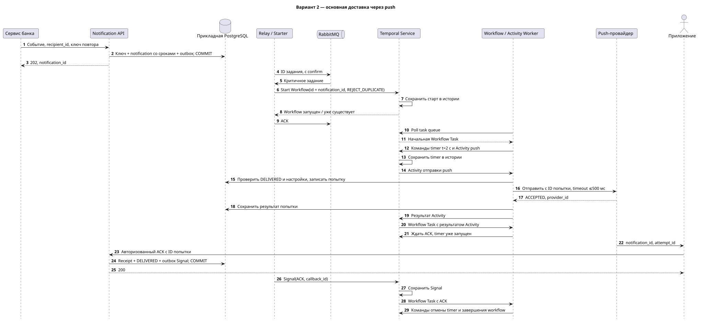
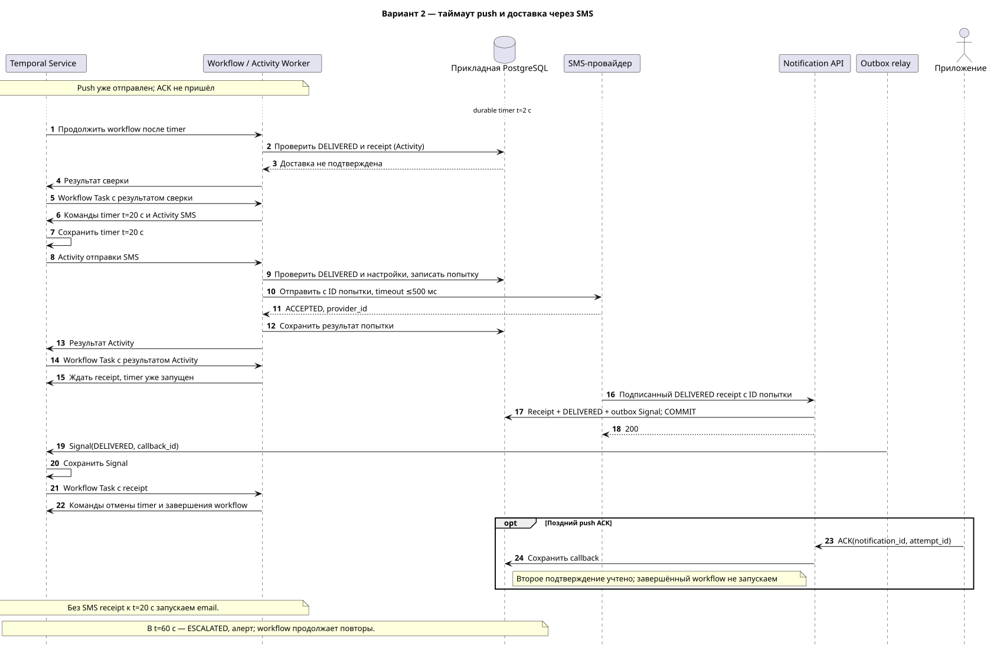

# RFC: Доставка критичных уведомлений с переключением каналов

| Метаданные | Значение |
| --- | --- |
| Статус | DESIGN |
| Автор | Иван Овчаров |
| Ответственный | Иван Овчаров |
| Бизнес-заказчик | Продуктовая команда онлайн-банка |
| Ревьюеры | Не назначены |
| Дата создания | 2026-11-16 |
| Дата обновления | 2026-11-16 |

## Оглавление

1. [Контекст](#контекст)
2. [Продуктовый анализ](#продуктовый-анализ)
3. [Пользовательские сценарии](#пользовательские-сценарии)
4. [Статистика](#статистика)
5. [Требования](#требования)
6. [Варианты решения](#варианты-решения)
7. [Сравнительный анализ](#сравнительный-анализ)
8. [Выводы](#выводы)
9. [Связанные задачи](#связанные-задачи)
10. [Приложения](#приложения)

## Контекст

Сейчас команды банка отправляют уведомления сами: сообщения задерживаются
и повторяются, общего статуса нет. Сделаем одну Notification Platform для
транзакционных, сервисных и маркетинговых уведомлений через push, SMS и email.
Для критичных сообщений нужен автоматический failover между каналами.

Подтверждение перевода и списания считаем критичными. Их нельзя отключить целиком,
но можно выбрать основной канал. Сервисные и маркетинговые сообщения отключаются
отдельно, маркетинг отправляем только при согласии. Список критичных типов задаёт
банк, отправитель не может объявить рекламу критичной.

Доставка — ACK приложения для push, delivery report оператора для SMS или
подтверждённый приём письма сервером адресата для email. Канал сохраняем:
это разные по силе подтверждения, ни одно не доказывает прочтение.
Успешный ответ API провайдера означает только приём задания;
у FCM [приём и доставка тоже разделены](https://firebase.google.com/docs/cloud-messaging/understand-delivery).

Принятое задание не теряем и продолжаем доставку до подтверждения либо ручного
разрешения проблемы. Для доставки нужен действующий контакт и хотя бы один
восстановившийся канал. При недоступности всех каналов сохраняем задание
и передаём проблему поддержке.

## Продуктовый анализ

| Цель из условия | Как измеряем | Что меняем |
| --- | --- | --- |
| BR1: retention +15% | Относительный рост D30 retention против контроля: `(R_new / R_control - 1) × 100%` | Полезные сообщения и подходящий канал |
| BR2: жалобы −30% | Число жалоб за месяц ≤70% базового; дополнительно обращения на 10 000 активных пользователей | Отписка и устранение дублей |
| BR3: доставка критичных сообщений | Доля подтверждённых доставок за 60 секунд и число незавершённых заданий | Учёт доставки, повторы и резервные каналы |

BR1 проверяем A/B-тестом с полной D30-когортой, критичные сообщения контролю
не отключаем. BR2 сравниваем с базовым месяцем, учитывая изменение аудитории.

## Пользовательские сценарии

| Приоритет | Тип | Действующее лицо | Сценарий |
| --- | --- | --- | --- |
| MUST HAVE | Транзакционный | Клиент банка | После перевода получает подтверждение; если push не дошёл, сообщение приходит по резервному каналу |
| MUST HAVE | Настройки | Клиент банка | Отключает рекламу и выбирает основной канал; критичные сообщения продолжают приходить |
| MUST HAVE | Кампания | Маркетолог | Отправляет предложение до 1 млн пользователей с учётом согласий |
| MUST HAVE | Повтор | Команда переводов | Повторно передаёт то же событие и получает тот же результат без второго задания |
| MUST HAVE | Разбор сбоя | Поддержка | Видит попытки, подтверждения и причину недоставки; может возобновить доставку |

## Статистика

Из условия: MAU 10 млн, DAU 3 млн, одновременно до 300 тыс. пользователей.
Считаем дневные отправки по DAU. Десятикратный пик, длительность кампании 15 минут,
размер записи и доли failover ниже — наши допущения, их нужно проверить.

| Тип | На активного пользователя в день | За день | В среднем в секунду |
| --- | ---: | ---: | ---: |
| Транзакционные | 2 | 6 млн | 69,4 |
| Сервисные | 3 | 9 млн | 104,2 |
| Маркетинговые | 5 | 15 млн | 173,6 |
| Всего | 10 | 30 млн | 347,2 |

## Требования

### Функциональные требования

| № | Приоритет | Обозначение | Требование и связь с целью |
| --- | --- | --- | --- |
| 1 | MUST HAVE | FR1 | Принимать уведомления трёх типов и отправлять их через push, SMS или email. BR1, BR3 |
| 2 | MUST HAVE | FR2 | Доставлять критичные сообщения независимо от рекламных рассылок. BR3 |
| 3 | MUST HAVE | FR3 | Учитывать выбранный канал, согласие на маркетинг и отдельное отключение сервисных сообщений. Полностью отключить критичные сообщения нельзя. BR1, BR2 |
| 4 | MUST HAVE | FR4 | После принятия критичного сообщения доводить его до подтверждённой доставки; при невозможности передавать проблему поддержке, сохраняя задание. BR3 |
| 5 | MUST HAVE | FR5 | При отказе основного канала автоматически пробовать следующий доступный. Без явного предпочтения сначала использовать более дешёвый канал. BR2, BR3 |
| 6 | MUST HAVE | FR6 | Повтор одного события в течение 30 дней не должен создавать второе уведомление. После подтверждения доставки прекращать новые попытки во всех каналах. BR2, BR3 |
| 7 | MUST HAVE | FR7 | Показывать отправителю и поддержке общий статус, историю попыток, канал и причину сбоя. BR2, BR3 |
| 8 | MUST HAVE | FR8 | Отправлять кампанию до 1 млн получателей с проверкой согласий перед отправкой. BR1, BR2 |

### Нефункциональные требования

Ниже целевые показатели. Задержку считаем от фиксации задания платформой
до фиксации подтверждения канала.

| № | Приоритет | Обозначение | Требование |
| --- | --- | --- | --- |
| 1 | MUST HAVE | NFR1 | За месяц p95 задержки критичных уведомлений ≤3 с, не менее 99,9% доставлены ≤60 с. Нарушение срока не удаляет задание |
| 2 | MUST HAVE | NFR2 | Доступность API приёма ≥99,95% за месяц; p99 ответа ≤200 мс при 5000 уведомлений/с |
| 3 | MUST HAVE | NFR3 | Принимать 5000 уведомлений/с, в том числе 700 критичных/с; запуск кампании на 1 млн за ≤15 минут не нарушает NFR1. Проверка с запасом — 6500/с |
| 4 | MUST HAVE | NFR4 | При отказе одного узла или зоны не терять подтверждённые задания: RPO=0; восстановить обработку ≤60 с. Проверять отключением зоны и сверкой ID |
| 5 | MUST HAVE | NFR5 | В окне 30 дней повтор не создаёт второго задания. Доля критичных уведомлений с receipt двух каналов ≤0,1% за месяц; учитываем и поздние receipt в пределах хранения |
| 6 | SHOULD HAVE | NFR6 | При исправном push и без явного выбора SMS доля SMS среди критичных сообщений ≤25% за месяц. При аварии бюджет не блокирует критичную доставку |
| 7 | MUST HAVE | NFR7 | Для 100% попыток сохранять ID, время, канал, результат и стоимость на 30 дней. Алерт ≤1 минуты, если доставка превысила 60 с или старейшее критичное задание ждёт обработки >1 с |
| 8 | MUST HAVE | NFR8 | Соединения API, БД, брокера и workflow-движка защищены TLS, включая API провайдеров; доступ ограничен ролью. В проверке логов — 0 текстов сообщений, телефонов и email |

NFR1 считаем по всем принятым критичным заданиям: недоступные получатели
тоже нарушают SLO. NFR2 допускает 21,6 минуты простоя за 30 дней.

### Расчёт нагрузок

```text
Среднее: 30 000 000 / 86 400 ≈ 347 уведомлений/с.
Пик ×10: 347,2 × 10 ≈ 3472/с, из них критичных ≈694/с.
Кампания: 1 000 000 / 900 ≈ 1111/с.
Пик вместе с дополнительной кампанией: 3472 + 1111 ≈ 4583/с.
Округляем до 5000/с, проверяем 6500/с с запасом 30%.
```

Кампанию добавили сверх обычного маркетинга как запас. 300 тыс. одновременных
пользователей не равны 300 тыс. отправок/с: действие не всегда создаёт уведомление.

Для маршрута по умолчанию примем 1 push, в 20% случаев ещё SMS, в 2% — email:
1,22 отправки на уведомление, около 854/с на пике 700 критичных/с, без retry.
При полном отказе push нужно 700 новых SMS/с: до 2100 API-попыток отправки/с.
Первый обход трёх отказавших каналов даёт до 6300 попыток отправки/с без сверок.
Для SMS API резервируем 5000 вызовов/с: 4000 на новые сообщения
(резерв 1000 сообщений/с × три отправки и одна сверка), 1000 на накопленные.
Квота общая на весь пул, повторы идут от старых к новым и не голодают.

Кампании выделяем 1200 заданий/с — 1 млн за 834 с; критичным резервируем
1000/с. Остальные 2800/с — сервисным сообщениям и обычному маркетингу.
Квоты каналов резервируем отдельно, при перегрузке тормозим маркетинг.

При среднем размере записи с попытками 1 КБ получаем 30 ГБ/день,
900 ГБ за 30 дней, с тремя копиями — 2,7 ТБ без индексов, WAL и бэкапов.
После завершения тексты и контакты храним 7 дней, историю и ключи повторов — 30.
Незавершённые критичные задания и их ключи не удаляем. Историю делим по датам,
ключи повторов храним отдельно с общей уникальностью на всё окно 30 дней.

При тех же долях и тарифах одной отправки C_push, C_sms, C_email стоимость дня без retry:
`6 млн × (C_push + 0,2 × C_sms + 0,02 × C_email)` против `6 млн × C_sms`
при отправке всего по SMS. SMS-затраты снижаются на 80%; остальные каналы,
повторы и пользовательские предпочтения меняют итог. Тарифы уточняем у провайдеров.

### Архитектурно значимые требования

| ASR | Приоритет | Связанные требования | Почему влияет и какие последствия |
| --- | --- | --- | --- |
| ASR1: быстрая доставка при массовых рассылках | P0 | FR2, FR8, NFR1–3 | Общая FIFO-очередь задержит переводы за рекламой. Нужны отдельные очереди, пулы работников и квоты, асинхронный приём и масштабирование |
| ASR2: сохранность и продолжение после сбоя | P0 | FR4, FR5, NFR2, NFR4 | Нельзя хранить задания и таймеры только в памяти. Нужны репликация, сохранённое состояние, outbox, восстановление и запасной канал |
| ASR3: защита от дублей при неизвестном результате | P0 | FR6, FR7, NFR5, NFR7 | Возможны повторы и поздние ответы. Нужны ключи идемпотентности, учёт попыток, последовательные переходы состояния и сверка с провайдером |
| ASR4: настройки и стоимость каналов | P1 | FR3, FR5, FR8, NFR6 | Нужна общая политика выбора канала, проверка согласий перед отправкой и учёт стоимости. Бюджет рекламы нельзя применять к критичной доставке |

### Ключевые архитектурные вопросы

| Вопрос | Откуда возник | Почему важен и что выбираем |
| --- | --- | --- |
| Ждать доставку в запросе отправителя или принять задание отдельно? | ASR1, ASR2 | Сбой SMS не должен задерживать перевод. Отвечаем после сохранения задания, доставку выполняем асинхронно |
| Что считать доставкой и когда менять канал? | ASR2, ASR3 | Ответ API не доказывает доставку. Ждём подтверждение канала до его срока; неизвестный результат сверяем, затем переключаемся |
| Где хранить состояние и таймеры: в своей БД или workflow-движке? | ASR2, ASR3 | От этого зависят восстановление и сложность сопровождения. Сравниваем оба варианта ниже |

### Решения, которые не подходят

| Решение | Нарушаемые ASR | Почему |
| --- | --- | --- |
| Отправлять через провайдера синхронно из запроса перевода, повторы хранить в памяти | ASR1, ASR2 | Провайдер задержит банковскую операцию, перезапуск потеряет задание |
| Сразу отправлять одно сообщение во все три канала | ASR3, ASR4 | Дубли становятся обычным поведением, SMS оплачиваем даже при исправном push |

### Неопределённости и риски

| Что неизвестно | Как проверить | Что изменится |
| --- | --- | --- |
| Частота из условия относится к DAU или MAU; каковы реальные пики? | Согласовать трактовку, взять недельную статистику банковских событий, прогнать оба профиля нагрузки | Мощность, число очередей и квоты |
| Есть ли receipt, привязка к попытке, идемпотентность, нужные квоты и тарифы? | Контрактные тесты потерянного ответа, раннего/позднего callback, 429 и полного failover; проверить договорённости | Провайдеры, стоимость, достижимость NFR1/NFR5 |
| Как часто push не подтверждается за 2 с и насколько долго приходят поздние ACK? | Пилот на разных устройствах, измерение p95/p99 и доли двух подтверждённых каналов | Срок ожидания push, доля SMS и бюджет |

## Варианты решения

### Общие правила доставки

Банк сохраняет событие и исходящий outbox одной транзакцией, повторяет передачу
до приёма платформой. Принимаем `source`, `event_id`, `recipient_id`, `type`,
`template_id` и параметры. Проверяем права источника на тип и шаблон.
Контакты и настройки обновляет приложение банка через API платформы.

Ключ повторов — `(source, event_id, recipient_id, type)`. Храним его и хеш
содержимого 30 дней: одинаковый повтор возвращает прежний `notification_id`,
изменённый — конфликт. Ключ, уведомление и outbox сохраняем одной транзакцией,
после синхронного commit отвечаем HTTP 202. Повтор обновляет last_seen_at ключа и ждёт
синхронного commit перед ответом. GET по ID возвращает статус.

Критичное уведомление бывает `PENDING`, `DELIVERED`, `ESCALATED`; последнее
не прекращает доставку. Попытка: `NEW → SENDING → ACCEPTED → DELIVERED`,
либо `FAILED`/`UNKNOWN`. Таймаут означает `UNKNOWN`, ответ API — `ACCEPTED`.
Попытку создаём до запроса, её ID передаём в client reference или callback URL,
чтобы сопоставить receipt даже раньше ответа отправки. Push содержит ID
уведомления и попытки, ACK приложения авторизован и привязан к пользователю.

Порядок по умолчанию — push → SMS → email. Предпочитаемый канал ставим первым,
остальные сохраняют этот порядок; отсутствующий контакт пропускаем.
Бюджеты каналов: push — 2 с, SMS — 18 с, email — 40 с. Маршрут и абсолютные
сроки сохраняем при приёме: по умолчанию t=2, 20, 60 с; для email — t=40, 42, 60 с.
При явном отказе не ждём срока. При истечении переключаемся не позднее чем
через 1 с, сверке статуса выделяем до 500 мс. SMS раньше email ради скорости
критичного сообщения; рекламу автоматически в SMS не переводим.
Перед каждой отправкой заново проверяем настройки и согласия.

Временные ошибки отправки повторяем до трёх попыток с паузами 100/200 мс и jitter
до 50 мс. Сетевой вызов ограничен 500 мс и сроком канала; 429 учитывает
Retry-After. Неверный контакт не повторяем. Ключ попытки при retry неизменен.
После неоднозначного ответа без идемпотентности слепой повтор запрещён:
сверяем статус, при неизвестном результате используем другой канал.
Сверка — один API-запрос до 500 мс. У push проверяем сохранённый ACK,
синхронный поиск статуса у FCM/APNs не предполагаем.

API проверяет подлинность, привязку и статус receipt, сохраняет его транзакцией.
При успехе в той же транзакции ставит `DELIVERED` и отменяет будущие шаги.
Отказ текущей попытки ускоряет failover, устаревший меняет только историю.
Ответ провайдеру — после commit.
Захват шага и receipt блокируют одну строку уведомления: подтверждение,
зафиксированное раньше захвата, запрещает отправку. Ещё раз проверяем состояние
перед запросом. `DELIVERED` не перезаписываем никаким поздним результатом.

Уже начатый запрос иногда нельзя отменить: между проверкой и внешней отправкой
нет общей транзакции. Поэтому исключаем логические повторы, но абсолютного
exactly-once между каналами не обещаем. Приложение убирает повторы по ID,
старые внешние отправки отменяем, где возможно; остаточные дубли измеряем по NFR5.

В t=60 с без receipt ставим `ESCALATED`, создаём алерт и продолжаем сверку
и безопасные повторы с backoff до 15 минут. При неверных контактах нужна поддержка.

### Вариант 1: PostgreSQL и RabbitMQ

#### Архитектура



API — FastAPI, relay и обработчики — Python. Данные и сроки храним в PostgreSQL.
Relay публикует outbox в RabbitMQ с `mandatory` и publisher confirms,
отмечает публикацию только после confirm и при отсутствии `basic.return`.
Повтор безопасен, доставка задания — at-least-once;
[confirm не означает обработку потребителем](https://www.rabbitmq.com/docs/confirms).

У каждого типа отдельные очереди и пулы, у критичных — резерв квот провайдеров.
RabbitMQ — три узла, [quorum queues с большинством](https://www.rabbitmq.com/docs/quorum-queues).
При переполнении отклоняем новые публикации, они остаются в outbox.

Работник короткой транзакцией захватывает шаг и создаёт lease до 1 с,
не дольше срока канала; между retry продлевает её с проверкой владельца.
Сетевой вызов — вне транзакции. Результат сохраняет,
снимает lease, затем отправляет ACK брокеру. Ожидание receipt lease не держит.
Задание содержит ID уведомления и версию шага; выполненная версия при повторе
сразу получает ACK. У пары «уведомление, шаг» одна сохранённая попытка.
Запись со старой версией lease запрещена. Просроченный захват означает сверку
результата, а не повторную отправку вслепую.

Планировщик каждые 250 мс выбирает `next_action_at` через `FOR UPDATE SKIP LOCKED`,
проверяет `DELIVERED` и receipt. Переход и outbox следующего шага фиксирует
одной транзакцией. После сбоя подбирает просроченные lease и сроки;
задания можно восстановить из БД даже при потере очереди.

PostgreSQL — primary и две реплики, commit ждёт хотя бы одну синхронную копию.
Patroni с [synchronous_mode и synchronous_mode_strict](https://patroni.readthedocs.io/en/latest/replication_modes.html)
продвигает только допустимую синхронную реплику, старый primary изолируется.
Без синхронной копии приём останавливаем. etcd — три узла; БД, брокер, API,
relay и пулы разнесены по трём зонам. Ошибки обработки уходят на разбор,
незавершённое задание остаётся в БД.





#### Этапы реализации

| Этап | Описание | Планируемый срок | Ресурсы | Риски |
| --- | --- | --- | --- | --- |
| 1 | Приём, настройки, ключ повторов, outbox и учёт попыток | 2 недели | 2 backend | Согласование типов и контактов |
| 2 | Три канала, callback, таймеры и сверка результатов | 2 недели | 2 backend, QA на половину времени | Разные гарантии провайдеров |
| 3 | Репликация, нагрузка, отключение зоны и пилот | 2 недели | 2 backend, SRE и QA на половину времени | Квоты и задержки доставки |

#### Преимущества

- Один источник состояния в PostgreSQL, видно, какой шаг и почему выполняется.
- Очереди и обработчики масштабируются независимо по типам уведомлений.
- Для цепочки из трёх каналов не нужен отдельный workflow-движок.

#### Недостатки

- Захваты, таймеры, сверку и восстановление после сбоев пишем сами.
- PostgreSQL принимает несколько изменений на уведомление; индексы и очистку надо проверять под нагрузкой.

### Вариант 2: Temporal для критичной доставки

#### Архитектура



Приём и некритичная доставка остаются как в варианте 1. Starter читает критичную
очередь и запускает workflow с ID уведомления. Указываем REJECT_DUPLICATE
для повторного использования ID; конфликт работающего workflow проверяем
как уже запущенную доставку. ACK брокеру — после подтверждённого старта
или проверки существующего workflow. Для `DELIVERED` новый workflow не запускаем:
проверка PostgreSQL действует и после очистки истории Temporal. Если workflow
завершился ошибкой без доставки, ставим `ESCALATED`: поддержка выполняет Reset
с сохранёнными ID попыток, а не принимает ошибку за успешный запуск.

Маршрут и таймеры исполняются в Python Workflow Worker, Temporal хранит историю
и восстанавливает выполнение. Таймер канала создаём до отправки Activity.
Отправки и сверка — идемпотентные Activities;
ожидание receipt — durable timer и Signal. Факт доставки в PostgreSQL проверяем
перед каждой отправкой, независимо от задержки Signal.
См. [workflow](https://docs.temporal.io/workflow-execution),
[политику ID](https://docs.temporal.io/workflow-execution/workflowid-runid)
и [идемпотентность Activities](https://temporal.io/blog/idempotency-and-durable-execution).

API фиксирует receipt, `DELIVERED` и outbox Signal одной транзакцией.
Relay повторяет Signal до приёма, workflow убирает дубли по ID callback
и отменяет таймеры. Поздний receipt учитывается в PostgreSQL; завершённый
workflow заново не запускаем. RetryPolicy Activities соответствует общим
лимитам; адаптеры дополнительный слой retry не добавляют.

У Temporal отдельная PostgreSQL истории с такой же синхронной репликацией;
Temporal и Workers также в трёх зонах. Долгие незавершённые workflow используют
Continue-As-New, чтобы история не росла бесконечно.





#### Этапы реализации

| Этап | Описание | Планируемый срок | Ресурсы | Риски |
| --- | --- | --- | --- | --- |
| 1 | Приём, outbox, очереди и кластер Temporal | 2 недели | 2 backend, SRE на половину времени | Развёртывание нового компонента |
| 2 | Workflow, Activities, callback и обновление статуса API | 3 недели | 2 backend, QA на половину времени | Повторы Activities и Signal |
| 3 | Нагрузка, сбои, совместимость версий workflow и пилот | 3 недели | 2 backend, SRE и QA на половину времени | Обновление незавершённых workflow |

#### Преимущества

- Таймеры, ожидание и восстановление описываются самим workflow.
- История шагов удобна для разбора сложных маршрутов.

#### Недостатки

- Дополнительный кластер и БД; состояние процесса и API надо согласовывать.
- Нужно соблюдать детерминизм workflow и совместимость новых версий со старой историей.
- Внешние дубли Temporal не устраняет: провайдер всё ещё вне его транзакции.

## Сравнительный анализ

### Ресурсные требования

| Критерий | Вариант 1 | Вариант 2 |
| --- | --- | --- |
| Время реализации | Около 6 недель | Около 8 недель |
| Команда | 2 backend, SRE и QA на часть времени | Та же команда, больше участия SRE |
| Инфраструктура | PostgreSQL, RabbitMQ, API и обработчики | Всё из варианта 1, Temporal и отдельная PostgreSQL |
| Организационные риски | Свой автомат доставки требует проверки гонок | Дополнительно нужны навыки эксплуатации и обновления workflow |

### Соответствие требованиям

| Требование | Вариант 1 | Вариант 2 |
| --- | --- | --- |
| FR1–3, FR8: каналы, изоляция, настройки и кампании | API, отдельные очереди/пулы, проверка согласий | Та же общая часть; отдельные Workers критичных workflow |
| FR4–5, ASR2: продолжение и failover | Репликация, outbox, next_action_at, сверка после lease | Та же защита приёма; durable workflow, timer и Activities |
| FR6, ASR3: повторы и дубли | Уникальный ключ, версия шага, receipt до запуска резерва | Workflow ID и политика повторного старта; Activities проверяют факт доставки |
| FR7, NFR7: статус и наблюдаемость | История в БД, метрики и trace_id | История в БД плюс история Temporal |
| ASR1, NFR1–3: скорость и масштаб | Очереди по типам, горизонтальные обработчики, резерв квот | То же плюс масштабирование Temporal и Workers; нужно проверить задержку запуска workflow |
| ASR4, NFR6: стоимость и настройки | Предпочтения, push первым по умолчанию | Та же политика внутри workflow |
| NFR4: потеря зоны | Синхронная PostgreSQL, quorum queues, экземпляры в трёх зонах | Дополнительно так же реплицирована БД Temporal |
| NFR5: дубли | Логические исключены в окне 30 дней; физические ограничиваем и измеряем | То же; workflow не даёт exactly-once внешнему каналу |
| NFR8: защита данных | TLS, роли, подпись callback, маскирование | То же; в истории Temporal только ID, без текста и контактов |

Нагрузку обоих вариантов проверяем с индексами, синхронной репликацией, callback,
очисткой и полным failover. Общая БД тоже может стать узким местом: резервируем
критичным соединения, ограничиваем маркетинг до ухудшения NFR1.

У варианта 2 при условных 20 событиях истории на сообщение дополнительно
120 млн событий/день и 14 тыс./с на пике. При 1 КБ на событие — ещё 120 ГБ/день
без реплик. Завершённую историю Temporal храним 7 дней, историю попыток в нашей
БД — 30 дней. Размеры и число событий проверяем на прототипе.

Метрики — Prometheus/Grafana, логи — Loki, трассы — OpenTelemetry/Tempo.
Наблюдаем задержку, возраст очереди, UNKNOWN, failover, долю SMS, два receipt
и стоимость. notification_id/trace_id используем в логах, не в метках метрик.

## Выводы

Выбран вариант 1: для трёх каналов достаточно сохранённого автомата и таймеров.
Цена выбора — своя логика восстановления и проверка гонок. Temporal сокращает
эту логику, но добавляет кластер, БД истории и сопровождение версий workflow.
Вернёмся к нему при усложнении маршрутов.

Ограничения: один регион, при потере кворума останавливаем приём ради сохранности;
физические дубли при failover полностью не исключаются. SLO доставки,
квоты и стоимость подтверждаем пилотом и нагрузочным тестом.

## Связанные задачи

| Задача | Результат |
| --- | --- |
| Согласовать типы, подтверждения и нагрузку | Зафиксированы критичные шаблоны, DAU/MAU и измеримый результат каждого канала |
| Проверить провайдеров | Есть квоты полного failover, контрактные тесты и оценка стоимости |
| Реализовать выбранный маршрут | Приём, outbox, попытки, callback, таймеры и настройки |
| Проверить перед пилотом | 6500/с вместе с кампанией; сбой узла/зоны; crash до и после отправки; потерянный ответ; повтор и поздний callback; отписка во время кампании |
| Провести пилот и A/B-тест | Измерены NFR1/NFR5/NFR6, retention и жалобы; определены условия расширения |

## Приложения

### Глоссарий

| Термин | Определение |
| --- | --- |
| ASR | Требование, которое меняет разбиение системы, хранение или взаимодействие |
| SLO | Измеримая целевая доля или задержка за заданный период |
| Outbox | Исходящее задание, сохранённое одной транзакцией с изменением данных |
| Failover | Переключение на резервный канал или узел после сбоя |
| Lease | Ограниченное по времени право работника выполнять шаг |
| RPO / RTO | Допустимая потеря данных / время восстановления |

Исходники схем — [PlantUML](diagrams/). C4 включён из стандартной библиотеки
PlantUML; SVG лежат рядом. Структура RFC взята из [шаблона задания](https://edu.tbank.ru/files/eea98023-983f-40ce-a6cc-59afc8796642).
